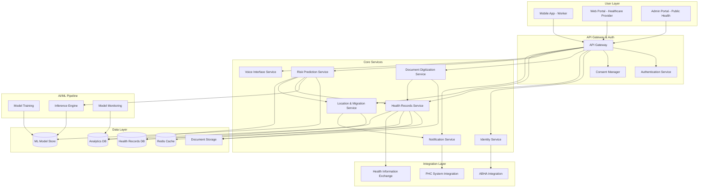
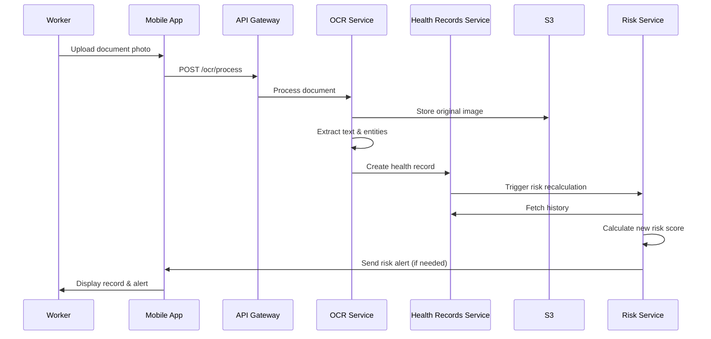
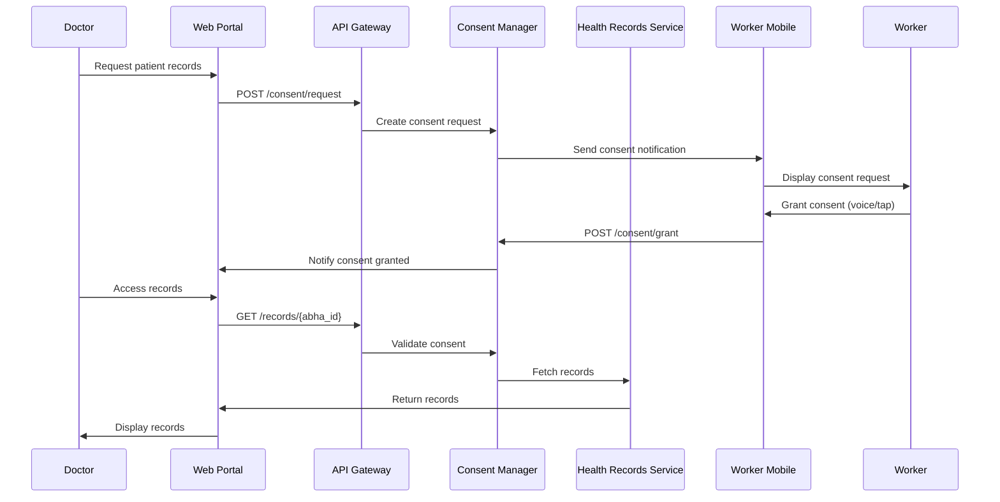
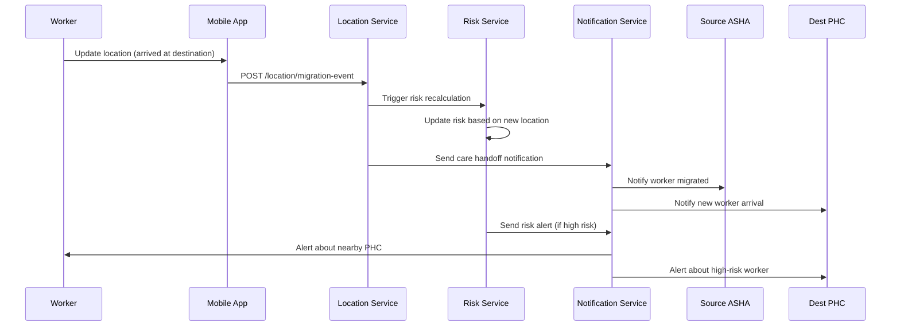
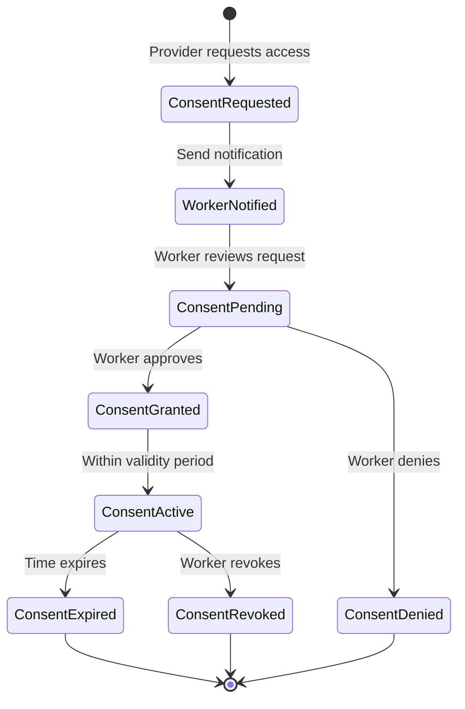
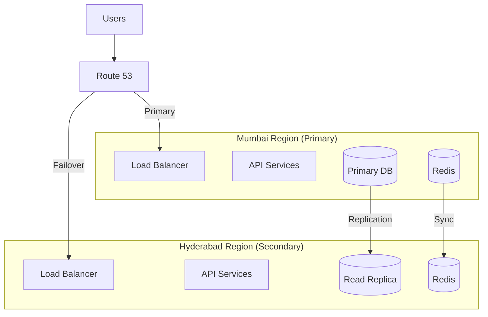

# Design Document: SwasthyaSetu

## Overview

SwasthyaSetu is a cloud-native, microservices-based platform that provides AI-powered occupational health intelligence and care continuity for India's migrant workers. The system architecture prioritizes scalability, offline-first mobile experience, privacy preservation, and ethical AI practices.

The platform consists of three primary layers:
1. **User Interface Layer**: Mobile apps (Android), voice interface, and web portals
2. **Application Services Layer**: Microservices for core business logic
3. **Data and AI Layer**: Health records storage, ML models, and analytics

Key architectural principles:
- Microservices for independent scaling and deployment
- Event-driven architecture for loose coupling
- API Gateway for unified access control
- Offline-first mobile design with sync capabilities
- Privacy by design with consent-driven data access
- Multi-region deployment for low latency across India


## Architecture

### High-Level Architecture



### Technology Stack

**Frontend:**
- Mobile: React Native (Android-first, iOS future)
- Web Portals: React.js with TypeScript
- Voice: Web Speech API, native speech recognition

**Backend:**
- Language: Python (FastAPI for services, Flask for ML inference)
- API Gateway: AWS API Gateway with Lambda authorizers
- Authentication: AWS Cognito with ABHA integration
- Message Queue: AWS SQS for async processing
- Event Bus: AWS EventBridge for event-driven workflows

**Data Storage:**
- Primary DB: PostgreSQL (AWS RDS) with read replicas
- Cache: Redis (AWS ElastiCache)
- Document Storage: AWS S3 with encryption
- Analytics: AWS Redshift for aggregated insights
- Search: AWS OpenSearch for health record search

**AI/ML:**
- OCR: AWS Textract + custom fine-tuned models for Indian languages
- Voice: AWS Transcribe + Polly with Indic language support
- Risk Prediction: Custom ML models (scikit-learn, XGBoost)
- Model Serving: AWS SageMaker
- Training Pipeline: AWS SageMaker Pipelines

**Infrastructure:**
- Cloud: AWS (multi-region: Mumbai, Hyderabad)
- Container Orchestration: AWS ECS with Fargate
- Infrastructure as Code: Terraform
- CI/CD: GitHub Actions
- Monitoring: AWS CloudWatch, Prometheus, Grafana
- Logging: AWS CloudWatch Logs, ELK Stack


## Components and Interfaces

### 1. Identity Service

**Responsibility:** Manage portable health identities linked with ABHA.

**Key Functions:**
- Create and link SwasthyaSetu profiles with ABHA IDs
- Generate QR codes for offline identity verification
- Validate identity credentials
- Manage user profiles and preferences

**API Endpoints:**
```
POST   /api/v1/identity/register
GET    /api/v1/identity/{abha_id}
POST   /api/v1/identity/link-abha
GET    /api/v1/identity/qr-code/{abha_id}
PUT    /api/v1/identity/{abha_id}/profile
POST   /api/v1/identity/verify-qr
```

**Data Model:**
```python
class UserIdentity:
    abha_id: str  # Primary identifier
    swasthya_id: str  # Internal UUID
    name: str
    date_of_birth: date
    gender: str
    phone_number: str
    preferred_language: str
    occupation_type: str
    created_at: datetime
    qr_code_data: str  # Encrypted offline verification data
```

**Integration Points:**
- ABHA API for ID creation and validation
- Consent Manager for access control
- Health Records Service for profile completion

### 2. Health Records Service

**Responsibility:** Store, retrieve, and manage health records with consent-based access.

**Key Functions:**
- Store digitized health records
- Retrieve records based on consent
- Maintain chronological care timeline
- Support FHIR-compliant data export
- Cache recent records for offline access

**API Endpoints:**
```
POST   /api/v1/records
GET    /api/v1/records/{abha_id}
GET    /api/v1/records/{abha_id}/timeline
POST   /api/v1/records/{abha_id}/share
GET    /api/v1/records/{record_id}
PUT    /api/v1/records/{record_id}
DELETE /api/v1/records/{record_id}
GET    /api/v1/records/{abha_id}/offline-cache
```

**Data Model:**
```python
class HealthRecord:
    record_id: str
    abha_id: str
    record_type: str  # prescription, lab_report, diagnosis, consultation
    date: date
    provider_id: str
    location: str
    structured_data: dict  # Extracted entities
    original_document_url: str  # S3 reference
    ocr_confidence: float
    created_at: datetime
    updated_at: datetime
    consent_required: bool

class MedicalEntity:
    entity_type: str  # medication, diagnosis, lab_test, symptom
    value: str
    confidence: float
    normalized_code: str  # SNOMED CT or ICD-10 code
```

**Integration Points:**
- Document Digitization Service for OCR results
- Consent Manager for access validation
- Risk Prediction Service for risk calculation
- ABHA HIE for interoperability

### 3. Document Digitization Service (OCR)

**Responsibility:** Convert paper medical documents to structured digital records.

**Key Functions:**
- Process document images (prescriptions, lab reports)
- Extract text using OCR with multi-language support
- Extract medical entities (medications, diagnoses, lab values)
- Validate extracted data quality
- Flag low-confidence extractions for review

**API Endpoints:**
```
POST   /api/v1/ocr/process
GET    /api/v1/ocr/status/{job_id}
GET    /api/v1/ocr/result/{job_id}
POST   /api/v1/ocr/review/{job_id}
```

**Processing Pipeline:**
```python
class OCRPipeline:
    def process_document(image: bytes, language: str) -> OCRResult:
        # 1. Image preprocessing (deskew, denoise, enhance)
        preprocessed = preprocess_image(image)
        
        # 2. Text extraction using AWS Textract + custom models
        raw_text = extract_text(preprocessed, language)
        
        # 3. Medical entity extraction using NER models
        entities = extract_medical_entities(raw_text, language)
        
        # 4. Structured data generation
        structured = structure_medical_data(entities)
        
        # 5. Confidence scoring
        confidence = calculate_confidence(raw_text, entities)
        
        return OCRResult(
            text=raw_text,
            entities=entities,
            structured_data=structured,
            confidence=confidence
        )
```

**Data Model:**
```python
class OCRJob:
    job_id: str
    abha_id: str
    document_url: str
    language: str
    status: str  # pending, processing, completed, failed, review_required
    result: OCRResult
    created_at: datetime
    completed_at: datetime

class OCRResult:
    raw_text: str
    confidence: float
    entities: List[MedicalEntity]
    structured_data: dict
    requires_review: bool
    review_notes: str
```

**Integration Points:**
- AWS Textract for base OCR
- Custom NER models for medical entity extraction
- Health Records Service for storing results
- S3 for document storage


### 4. Risk Prediction Service (Migration-Aware Occupational Health Intelligence Engine)

**Responsibility:** Calculate occupational health risk scores based on migration patterns, occupation, and health history.

**Key Functions:**
- Calculate risk scores for occupational diseases
- Correlate occupation, migration, environment, and health data
- Generate explainable risk alerts
- Trigger health check reminders
- Update risk scores when new data arrives

**API Endpoints:**
```
POST   /api/v1/risk/calculate/{abha_id}
GET    /api/v1/risk/score/{abha_id}
GET    /api/v1/risk/alerts/{abha_id}
POST   /api/v1/risk/feedback/{alert_id}
GET    /api/v1/risk/explanation/{abha_id}/{risk_type}
```

**Risk Calculation Engine:**
```python
class RiskPredictionEngine:
    def calculate_risk_score(
        occupation: str,
        migration_data: MigrationData,
        health_records: List[HealthRecord],
        environmental_factors: dict
    ) -> RiskScore:
        
        # Feature engineering
        features = {
            'occupation_category': encode_occupation(occupation),
            'migration_duration_months': migration_data.duration_months,
            'source_region': encode_region(migration_data.source),
            'destination_region': encode_region(migration_data.destination),
            'destination_environment': environmental_factors,
            'symptom_patterns': extract_symptom_patterns(health_records),
            'exposure_duration': calculate_exposure_duration(migration_data),
            'age': calculate_age(health_records),
            'previous_conditions': extract_conditions(health_records)
        }
        
        # Risk prediction for multiple disease categories
        risks = {
            'silicosis': predict_silicosis_risk(features),
            'tuberculosis': predict_tb_risk(features),
            'musculoskeletal': predict_msk_risk(features),
            'anemia': predict_anemia_risk(features),
            'respiratory': predict_respiratory_risk(features)
        }
        
        # Generate explanations
        explanations = generate_explanations(features, risks)
        
        # Determine alert level
        alert_level = determine_alert_level(risks)
        
        return RiskScore(
            overall_score=max(risks.values()),
            disease_risks=risks,
            explanations=explanations,
            alert_level=alert_level,
            recommended_actions=generate_recommendations(risks)
        )
```

**Data Model:**
```python
class MigrationData:
    source_location: str
    destination_location: str
    migration_start_date: date
    duration_months: int
    return_frequency: str  # never, yearly, seasonal
    current_location: str

class RiskScore:
    abha_id: str
    overall_score: float  # 0-100
    disease_risks: dict  # disease_type -> risk_score
    alert_level: str  # low, medium, high, critical
    explanations: dict  # disease_type -> explanation
    recommended_actions: List[str]
    calculated_at: datetime
    model_version: str
    contributing_factors: List[str]

class RiskAlert:
    alert_id: str
    abha_id: str
    risk_type: str
    severity: str
    message: str
    explanation: str
    recommended_actions: List[str]
    created_at: datetime
    acknowledged: bool
    feedback: str
```

**ML Model Architecture:**

The Risk Prediction Engine uses an ensemble approach:

1. **Occupation-Disease Risk Matrix**: Pre-computed risk associations
   - Construction → Silicosis (high), MSK disorders (high)
   - Mining → Silicosis (very high), TB (high)
   - Agriculture → Pesticide exposure (medium), MSK (medium)

2. **Migration Pattern Analyzer**: XGBoost model
   - Features: duration, source-destination corridor, return frequency
   - Predicts: exposure intensity multiplier

3. **Symptom Pattern Matcher**: NLP-based similarity
   - Matches reported symptoms to disease signatures
   - Uses multilingual medical NER

4. **Temporal Risk Tracker**: Time-series model
   - Tracks risk evolution over migration duration
   - Triggers alerts when risk trajectory increases

5. **Ensemble Combiner**: Weighted combination
   - Combines all model outputs
   - Applies calibration for interpretable probabilities

**Explainability:**
```python
class RiskExplanation:
    def generate_explanation(features: dict, risk_score: float) -> str:
        # SHAP values for feature importance
        shap_values = calculate_shap_values(features, risk_score)
        
        # Top contributing factors
        top_factors = get_top_factors(shap_values, n=3)
        
        # Generate plain language explanation
        explanation = f"Your {risk_type} risk is {risk_level} because:\n"
        for factor, contribution in top_factors:
            explanation += f"- {translate_factor(factor, contribution)}\n"
        
        explanation += "\nThis is NOT a diagnosis. Please consult a doctor."
        
        return explanation
```

**Integration Points:**
- Health Records Service for medical history
- Location & Migration Service for migration patterns
- Notification Service for alerts
- Analytics DB for model monitoring


### 5. Voice Interface Service

**Responsibility:** Enable voice-based interaction in multiple Indian languages.

**Key Functions:**
- Speech-to-text transcription
- Text-to-speech synthesis
- Language detection and switching
- Noise cancellation
- Voice command routing

**API Endpoints:**
```
POST   /api/v1/voice/transcribe
POST   /api/v1/voice/synthesize
POST   /api/v1/voice/detect-language
GET    /api/v1/voice/supported-languages
POST   /api/v1/voice/command
```

**Voice Processing Pipeline:**
```python
class VoiceInterface:
    def process_voice_input(
        audio: bytes,
        language: str,
        context: str
    ) -> VoiceResponse:
        
        # 1. Noise reduction
        clean_audio = reduce_noise(audio)
        
        # 2. Speech-to-text
        text = transcribe_speech(clean_audio, language)
        
        # 3. Intent recognition
        intent = recognize_intent(text, context)
        
        # 4. Execute command
        result = execute_command(intent)
        
        # 5. Generate response
        response_text = generate_response(result, language)
        
        # 6. Text-to-speech
        response_audio = synthesize_speech(response_text, language)
        
        return VoiceResponse(
            transcribed_text=text,
            intent=intent,
            response_text=response_text,
            response_audio=response_audio
        )
```

**Supported Languages:**
- Hindi, Tamil, Telugu, Bengali, Marathi
- Gujarati, Kannada, Malayalam, Punjabi, Odia

**Integration Points:**
- AWS Transcribe for speech-to-text
- AWS Polly for text-to-speech
- Custom intent recognition models
- All core services for command execution

### 6. Location & Migration Service

**Responsibility:** Track worker locations and migration patterns.

**Key Functions:**
- Record migration events
- Track current location
- Identify migration corridors
- Calculate migration duration
- Find nearby healthcare facilities

**API Endpoints:**
```
POST   /api/v1/location/update
GET    /api/v1/location/{abha_id}/current
GET    /api/v1/location/{abha_id}/history
POST   /api/v1/location/migration-event
GET    /api/v1/location/nearby-facilities
GET    /api/v1/location/{abha_id}/migration-pattern
```

**Data Model:**
```python
class MigrationEvent:
    event_id: str
    abha_id: str
    event_type: str  # departure, arrival, return
    location: str
    timestamp: datetime
    source_location: str
    destination_location: str

class LocationHistory:
    abha_id: str
    locations: List[LocationPoint]
    migration_pattern: MigrationPattern

class MigrationPattern:
    source_location: str
    destination_locations: List[str]
    migration_frequency: str
    average_duration_months: int
    current_migration_duration: int
    last_return_date: date
```

### 7. Consent Manager

**Responsibility:** Manage consent-based data access and privacy controls.

**Key Functions:**
- Request and grant consent
- Validate consent for data access
- Revoke consent
- Log all access events
- Support time-bound and scope-limited consent

**API Endpoints:**
```
POST   /api/v1/consent/request
POST   /api/v1/consent/grant
POST   /api/v1/consent/revoke
GET    /api/v1/consent/{abha_id}/active
GET    /api/v1/consent/access-log/{abha_id}
POST   /api/v1/consent/validate
```

**Data Model:**
```python
class ConsentRequest:
    request_id: str
    requester_id: str  # Healthcare provider ID
    requester_type: str  # phc_doctor, asha_worker, specialist
    abha_id: str
    purpose: str
    data_scope: List[str]  # specific record types or time periods
    requested_at: datetime
    status: str  # pending, granted, denied, expired

class ConsentGrant:
    consent_id: str
    request_id: str
    abha_id: str
    granted_to: str
    data_scope: List[str]
    duration_type: str  # one_time, days_7, days_30, ongoing
    granted_at: datetime
    expires_at: datetime
    revoked: bool
    revoked_at: datetime

class AccessLog:
    log_id: str
    consent_id: str
    accessor_id: str
    abha_id: str
    data_accessed: List[str]
    access_timestamp: datetime
    ip_address: str
    purpose: str
```

**Consent Validation Flow:**
```python
class ConsentValidator:
    def validate_access(
        accessor_id: str,
        abha_id: str,
        data_scope: List[str]
    ) -> bool:
        
        # 1. Find active consent grants
        active_consents = get_active_consents(abha_id, accessor_id)
        
        # 2. Check if requested data is within scope
        for consent in active_consents:
            if is_within_scope(data_scope, consent.data_scope):
                if not is_expired(consent):
                    # 3. Log access
                    log_access(consent, accessor_id, data_scope)
                    return True
        
        return False
```

### 8. Notification Service

**Responsibility:** Send alerts and notifications to workers and healthcare providers.

**Key Functions:**
- Send risk alerts to workers
- Notify ASHA workers of care events
- Send health check reminders
- Coordinate care handoffs
- Support SMS, push notifications, and voice calls

**API Endpoints:**
```
POST   /api/v1/notifications/send
GET    /api/v1/notifications/{abha_id}
PUT    /api/v1/notifications/{notification_id}/acknowledge
POST   /api/v1/notifications/bulk
GET    /api/v1/notifications/preferences/{abha_id}
```

**Data Model:**
```python
class Notification:
    notification_id: str
    recipient_id: str
    recipient_type: str  # worker, asha, doctor
    notification_type: str  # risk_alert, care_handoff, reminder
    priority: str  # low, medium, high, urgent
    channel: str  # sms, push, voice
    message: str
    language: str
    sent_at: datetime
    delivered_at: datetime
    acknowledged: bool
    acknowledged_at: datetime
```


## Data Models

### Core Entities

**User Identity:**
```python
class User:
    abha_id: str  # Primary key
    swasthya_id: str  # UUID
    name: str
    date_of_birth: date
    gender: str
    phone_number: str
    preferred_language: str
    occupation_type: str
    literacy_level: str
    created_at: datetime
    last_active: datetime
    qr_code_hash: str
```

**Health Record:**
```python
class HealthRecord:
    record_id: str  # Primary key
    abha_id: str  # Foreign key
    record_type: str
    date: date
    provider_id: str
    location: str
    structured_data: JSONB
    document_url: str
    ocr_confidence: float
    fhir_resource: JSONB
    created_at: datetime
    updated_at: datetime
```

**Risk Assessment:**
```python
class RiskAssessment:
    assessment_id: str  # Primary key
    abha_id: str  # Foreign key
    overall_risk_score: float
    disease_risks: JSONB
    alert_level: str
    explanations: JSONB
    contributing_factors: JSONB
    model_version: str
    calculated_at: datetime
```

**Migration Record:**
```python
class MigrationRecord:
    migration_id: str  # Primary key
    abha_id: str  # Foreign key
    source_location: str
    destination_location: str
    departure_date: date
    return_date: date
    duration_months: int
    migration_type: str  # seasonal, permanent, circular
    occupation_at_destination: str
```

### Database Schema Design

**Partitioning Strategy:**
- Health records partitioned by date (monthly partitions)
- Migration records partitioned by year
- Risk assessments partitioned by calculation date

**Indexing Strategy:**
```sql
-- User lookups
CREATE INDEX idx_user_abha ON users(abha_id);
CREATE INDEX idx_user_phone ON users(phone_number);

-- Health record queries
CREATE INDEX idx_health_record_abha ON health_records(abha_id, date DESC);
CREATE INDEX idx_health_record_type ON health_records(record_type, date DESC);

-- Risk assessments
CREATE INDEX idx_risk_abha ON risk_assessments(abha_id, calculated_at DESC);
CREATE INDEX idx_risk_alert ON risk_assessments(alert_level, calculated_at DESC);

-- Migration patterns
CREATE INDEX idx_migration_abha ON migration_records(abha_id, departure_date DESC);
CREATE INDEX idx_migration_corridor ON migration_records(source_location, destination_location);

-- Consent management
CREATE INDEX idx_consent_abha ON consent_grants(abha_id, expires_at);
CREATE INDEX idx_consent_accessor ON consent_grants(granted_to, expires_at);
```

**Data Retention:**
- Health records: 7 years (regulatory requirement)
- Risk assessments: 2 years
- Access logs: 7 years
- Migration records: Indefinite (anonymized after 7 years)
- Consent grants: 7 years after expiration

### Data Flow

**Health Record Creation Flow:**


**Consent-Based Data Access Flow:**


**Migration Event and Care Continuity Flow:**



## Correctness Properties

*A property is a characteristic or behavior that should hold true across all valid executions of a system—essentially, a formal statement about what the system should do. Properties serve as the bridge between human-readable specifications and machine-verifiable correctness guarantees.*

### Property 1: Unique Identity Creation

*For any* worker registration with valid data, the system should create a unique health identity that is properly linked to the provided ABHA ID, and no two registrations should produce the same SwasthyaSetu ID.

**Validates: Requirements 1.1**

### Property 2: QR Code Round-Trip Consistency

*For any* valid user identity, generating a QR code and then decoding it (even in offline mode) should produce the same identity information, enabling offline identity verification.

**Validates: Requirements 1.3, 1.4, 1.6**

### Property 3: Migration Event Recording

*For any* location update by a worker, the system should create a migration event record containing timestamp, source location, destination location, and worker ID.

**Validates: Requirements 1.5**

### Property 4: Multi-Language OCR Support

*For any* document in a supported language (Hindi, Tamil, Telugu, Bengali, Marathi, Gujarati, Kannada, Malayalam, Punjabi, Odia), the OCR engine should process it and return structured results without errors.

**Validates: Requirements 2.2**

### Property 5: OCR Output Structuring

*For any* OCR extraction result, the system should transform it into a health record that conforms to the standardized schema with all required fields present.

**Validates: Requirements 2.3**

### Property 6: Low-Confidence OCR Flagging

*For any* OCR result where confidence score is below 70%, the system should flag the record for manual review.

**Validates: Requirements 2.4**

### Property 7: Medical Entity Extraction Completeness

*For any* medical document containing medications, dosages, diagnoses, lab values, or dates, the OCR system should extract these entities and include them in the structured output.

**Validates: Requirements 2.5**

### Property 8: Lab Value Validation

*For any* digitized lab report containing numerical values, the system should validate those values against normal ranges and record the validation results.

**Validates: Requirements 2.6**

### Property 9: Document Preservation

*For any* document processed through OCR, both the original image and the extracted structured data should be stored and retrievable.

**Validates: Requirements 2.7**

### Property 10: Occupation Hazard Identification

*For any* valid occupation type registered by a worker, the risk prediction engine should identify and return associated occupational hazards.

**Validates: Requirements 3.1**

### Property 11: Risk Alert Generation

*For any* risk score that exceeds the defined threshold, the system should generate an alert containing recommended actions and a clear disclaimer that it is NOT a medical diagnosis.

**Validates: Requirements 3.4**

### Property 12: Risk Calculation Input Completeness

*For any* risk score calculation, the system should consider all required factors: occupation type, migration source and destination, duration of migration, environmental exposure, workplace conditions, and health record patterns.

**Validates: Requirements 3.5**

### Property 13: Risk Explanation Presence

*For any* generated risk score, the system should provide an explainable reasoning that describes the contributing factors in plain language.

**Validates: Requirements 3.6**

### Property 14: Risk Score Recalculation on New Data

*For any* worker, when a new health record is added, the system should trigger a risk score recalculation that incorporates the new information.

**Validates: Requirements 3.7**

### Property 15: Voice Interface Language Support

*For any* supported language (Hindi, Tamil, Telugu, Bengali, Marathi, Gujarati, Kannada, Malayalam, Punjabi, Odia), the voice interface should accept voice input and produce voice output in that language.

**Validates: Requirements 4.1**

### Property 16: Text-to-Speech Generation

*For any* text response and selected language, the voice interface should generate speech audio in the specified language.

**Validates: Requirements 4.3**

### Property 17: Language Preference Persistence

*For any* worker, when they change their language preference, all subsequent system interactions should use the newly selected language.

**Validates: Requirements 4.4**

### Property 18: Voice Failure Fallback

*For any* voice input that fails to process, the system should provide visual fallback options to the user.

**Validates: Requirements 4.6**

### Property 19: PHC Visit Notification

*For any* worker consultation at a destination PHC, the system should send a notification to the worker's source ASHA worker about the consultation event.

**Validates: Requirements 5.1**

### Property 20: Return Migration Data Transfer

*For any* worker returning to their source location, the system should make all destination health records accessible to the source PHC.

**Validates: Requirements 5.2**

### Property 21: Consent-Based Care Plan Sharing

*For any* care plan created at a destination, the system should make it accessible to source healthcare providers only when valid worker consent exists.

**Validates: Requirements 5.3**

### Property 22: Location-Based Alert Routing

*For any* follow-up care alert, the system should route it to the ASHA worker associated with the worker's current location.

**Validates: Requirements 5.4**

### Property 23: Chronological Care Timeline

*For any* worker with health events across multiple locations, the system should maintain a timeline where all events are ordered chronologically regardless of location.

**Validates: Requirements 5.5**

### Property 24: Migration Facility Discovery

*For any* worker migration to a new destination, the system should identify and return nearby PHCs and ASHA workers.

**Validates: Requirements 5.6**

### Property 25: Care Handoff Note Storage

*For any* care handoff note created by a provider, the system should store it and make it retrievable by the receiving provider with appropriate consent.

**Validates: Requirements 5.7**

### Property 26: Consent Request Triggering

*For any* healthcare provider request to access health records, the system should trigger a consent prompt to the worker.

**Validates: Requirements 6.1**

### Property 27: Consent Scope Specification

*For any* consent grant, the system should allow and record the data scope (specific records or time period) specified by the worker.

**Validates: Requirements 6.2**

### Property 28: Consent Duration Specification

*For any* consent grant, the system should allow and record the duration (one-time, 7 days, 30 days, or ongoing) specified by the worker.

**Validates: Requirements 6.3**

### Property 29: Data Access Audit Logging

*For any* access to health records, the system should create an audit log entry containing timestamp, accessor identity, and data accessed.

**Validates: Requirements 6.4**

### Property 30: Consent Enforcement

*For any* data access request, if the consent has been revoked or has expired, the system should block access to the health records.

**Validates: Requirements 6.5, 6.7**

### Property 31: Data Encryption

*For any* health record stored or transmitted, the system should encrypt it using the specified encryption standards (AES-256 at rest, TLS 1.3 in transit).

**Validates: Requirements 6.8, 12.6, 12.7**

### Property 32: Offline Data Access

*For any* device in offline mode, the system should display cached health summary and recent records without requiring internet connectivity.

**Validates: Requirements 7.1**

### Property 33: Offline Operation Queuing

*For any* health record upload attempted while offline, the system should queue the operation and sync it when connectivity is restored.

**Validates: Requirements 7.3**

### Property 34: Cache Size Maintenance

*For any* worker's offline cache, the system should maintain exactly the most recent 50 health records for offline access.

**Validates: Requirements 7.5**

### Property 35: Offline Sync Timestamp Display

*For any* device in offline mode, the system should display the timestamp of the last successful synchronization.

**Validates: Requirements 7.6**

### Property 36: Offline Core Feature Availability

*For any* device in offline mode, the core features (view records, generate QR, record symptoms) should remain functional without internet connectivity.

**Validates: Requirements 7.7**

### Property 37: Anonymized Aggregation

*For any* public health report generated, the aggregated data should contain no personal identifiers (name, ABHA ID, phone number, exact location).

**Validates: Requirements 8.1**

### Property 38: Occupational Disease Aggregation Dimensions

*For any* public health report on occupational diseases, the system should provide breakdowns by occupation type and migration corridor.

**Validates: Requirements 8.2**

### Property 39: Geographic Aggregation Granularity

*For any* geographic health pattern display, the system should aggregate location data to district level or higher, never showing individual locations.

**Validates: Requirements 8.4**

### Property 40: K-Anonymity in Aggregations

*For any* aggregated dataset exported, the system should ensure it contains data from a minimum of 100 individuals to prevent re-identification.

**Validates: Requirements 8.5**

### Property 41: Differential Privacy in Exports

*For any* anonymized data export, the system should apply differential privacy techniques (noise addition) to prevent re-identification.

**Validates: Requirements 8.7**

### Property 42: ABHA Linking

*For any* worker with an existing ABHA ID, the system should link it to their SwasthyaSetu profile during registration.

**Validates: Requirements 9.1**

### Property 43: ABHA as Primary Identifier

*For any* health record created, the system should use ABHA ID as the primary identifier for linking and retrieval.

**Validates: Requirements 9.3**

### Property 44: FHIR-Compliant Data Sharing

*For any* health record shared with external systems, the system should format it according to FHIR standards and validate schema compliance.

**Validates: Requirements 9.5**

### Property 45: Risk Output Labeling and Disclaimers

*For any* risk score or prediction displayed, the system should include clear labels indicating it is a "risk indicator" (NOT a diagnosis) and include a disclaimer that medical consultation is required.

**Validates: Requirements 10.2, 10.3**

### Property 46: Risk Prediction Audit Logging

*For any* risk prediction generated, the system should log the model version and input features used for the calculation to enable auditability.

**Validates: Requirements 10.6**

### Property 47: Prediction Feedback Mechanism

*For any* risk prediction shown to a worker, the system should provide an option for the worker to report incorrect or concerning predictions.

**Validates: Requirements 10.7**

### Property 48: Role-Based Access Control

*For any* user attempting to access system resources, the system should enforce access control based on their assigned role (worker, ASHA worker, PHC doctor, admin).

**Validates: Requirements 12.3**

### Property 49: Healthcare Provider MFA Requirement

*For any* healthcare provider account login attempt, the system should require multi-factor authentication before granting access.

**Validates: Requirements 12.8**

### Property 50: Data Deletion with Anonymized Preservation

*For any* worker data deletion request, the system should delete all personal identifiable information within 30 days while preserving anonymized aggregates for public health insights.

**Validates: Requirements 12.10**


## Error Handling

### Error Categories

**1. User Input Errors:**
- Invalid ABHA ID format
- Missing required registration fields
- Invalid phone number format
- Unsupported language selection

**Handling Strategy:**
- Validate input at API gateway level
- Return HTTP 400 with clear error messages in user's language
- Provide voice feedback for voice interface errors
- Suggest corrections where possible

**2. OCR Processing Errors:**
- Image quality too low
- Unsupported document format
- OCR confidence below threshold
- Entity extraction failures

**Handling Strategy:**
- Return partial results with confidence scores
- Flag for manual review when confidence < 70%
- Provide guidance on retaking photos
- Store original image for later reprocessing

**3. Consent and Authorization Errors:**
- Expired consent
- Revoked consent
- Missing consent for requested data
- Invalid access token

**Handling Strategy:**
- Return HTTP 403 with specific reason
- Trigger consent request workflow
- Log all authorization failures for audit
- Notify worker of unauthorized access attempts

**4. External Integration Errors:**
- ABHA API unavailable
- PHC system connection failure
- HIE timeout
- SMS/notification delivery failure

**Handling Strategy:**
- Implement retry with exponential backoff (3 attempts)
- Queue operations for later retry
- Provide degraded functionality when possible
- Alert administrators for prolonged outages
- Cache ABHA validation results for offline operation

**5. Data Consistency Errors:**
- Duplicate health records
- Conflicting migration events
- Invalid risk score calculations
- Missing required entities

**Handling Strategy:**
- Implement idempotency keys for all write operations
- Use database transactions for multi-step operations
- Validate data integrity before committing
- Implement conflict resolution for offline sync

**6. System Resource Errors:**
- Database connection pool exhausted
- S3 storage quota exceeded
- ML model inference timeout
- Memory limits exceeded

**Handling Strategy:**
- Implement circuit breakers for failing services
- Auto-scale resources based on load
- Implement request queuing with priority
- Graceful degradation (e.g., skip risk calculation if timeout)

### Error Response Format

```json
{
  "error": {
    "code": "CONSENT_EXPIRED",
    "message": "The consent for accessing this health record has expired",
    "message_localized": "इस स्वास्थ्य रिकॉर्ड तक पहुंचने की सहमति समाप्त हो गई है",
    "details": {
      "consent_id": "consent_123",
      "expired_at": "2024-01-15T10:30:00Z"
    },
    "suggested_action": "Request new consent from the worker",
    "support_reference": "ERR_2024_001234"
  }
}
```

### Retry and Resilience Patterns

**Circuit Breaker:**
- Implemented for all external service calls
- Open circuit after 5 consecutive failures
- Half-open state after 30 seconds
- Close circuit after 3 successful calls

**Retry Logic:**
- Exponential backoff: 1s, 2s, 4s
- Maximum 3 retry attempts
- Idempotent operations only
- Jitter to prevent thundering herd

**Timeout Configuration:**
- API Gateway: 30 seconds
- Database queries: 5 seconds
- OCR processing: 30 seconds
- ML inference: 10 seconds
- External API calls: 15 seconds

**Fallback Strategies:**
- Use cached data when real-time fetch fails
- Skip optional enrichments (e.g., risk calculation) if timeout
- Provide partial results with warnings
- Queue operations for async processing


## Testing Strategy

### Dual Testing Approach

SwasthyaSetu requires both unit testing and property-based testing for comprehensive coverage:

**Unit Tests:**
- Specific examples demonstrating correct behavior
- Edge cases and boundary conditions
- Error handling scenarios
- Integration points between components
- Mock external dependencies (ABHA API, AWS services)

**Property-Based Tests:**
- Universal properties that hold for all inputs
- Comprehensive input coverage through randomization
- Catch unexpected edge cases through fuzzing
- Validate correctness properties from design document
- Each property test runs minimum 100 iterations

Both approaches are complementary and necessary. Unit tests catch concrete bugs in specific scenarios, while property tests verify general correctness across all inputs.

### Property-Based Testing Configuration

**Framework:** Hypothesis (Python)

**Configuration:**
```python
from hypothesis import given, settings, strategies as st

# Global settings for all property tests
settings.register_profile("swasthya_setu", 
    max_examples=100,  # Minimum 100 iterations per test
    deadline=5000,     # 5 second timeout per example
    suppress_health_check=[HealthCheck.too_slow]
)
settings.load_profile("swasthya_setu")
```

**Test Tagging:**
Each property test must reference its design document property:

```python
@given(worker=worker_strategy(), abha_id=abha_id_strategy())
def test_unique_identity_creation(worker, abha_id):
    """
    Feature: swasthya-setu-core, Property 1: Unique Identity Creation
    
    For any worker registration with valid data, the system should create 
    a unique health identity that is properly linked to the provided ABHA ID.
    """
    # Test implementation
    pass
```

### Test Data Strategies

**Custom Hypothesis Strategies:**

```python
# ABHA ID: 14-digit number
@st.composite
def abha_id_strategy(draw):
    return draw(st.integers(min_value=10**13, max_value=10**14-1))

# Worker data
@st.composite
def worker_strategy(draw):
    return {
        'name': draw(st.text(min_size=2, max_size=50)),
        'date_of_birth': draw(st.dates(min_value=date(1950, 1, 1))),
        'gender': draw(st.sampled_from(['M', 'F', 'O'])),
        'phone': draw(st.integers(min_value=6000000000, max_value=9999999999)),
        'language': draw(st.sampled_from([
            'hindi', 'tamil', 'telugu', 'bengali', 'marathi',
            'gujarati', 'kannada', 'malayalam', 'punjabi', 'odia'
        ])),
        'occupation': draw(st.sampled_from([
            'construction', 'mining', 'agriculture', 'domestic',
            'manufacturing', 'transport', 'retail'
        ]))
    }

# Health record
@st.composite
def health_record_strategy(draw):
    return {
        'record_type': draw(st.sampled_from([
            'prescription', 'lab_report', 'diagnosis', 'consultation'
        ])),
        'date': draw(st.dates()),
        'provider_id': draw(st.uuids()),
        'location': draw(st.text(min_size=5, max_size=50)),
        'structured_data': draw(st.dictionaries(
            keys=st.text(min_size=1, max_size=20),
            values=st.text(min_size=1, max_size=100)
        ))
    }

# Migration data
@st.composite
def migration_strategy(draw):
    source = draw(st.text(min_size=5, max_size=30))
    destination = draw(st.text(min_size=5, max_size=30))
    assume(source != destination)  # Source and destination must differ
    
    return {
        'source_location': source,
        'destination_location': destination,
        'duration_months': draw(st.integers(min_value=1, max_value=120)),
        'migration_type': draw(st.sampled_from([
            'seasonal', 'permanent', 'circular'
        ]))
    }

# OCR result
@st.composite
def ocr_result_strategy(draw):
    confidence = draw(st.floats(min_value=0.0, max_value=1.0))
    return {
        'raw_text': draw(st.text(min_size=10, max_size=500)),
        'confidence': confidence,
        'entities': draw(st.lists(
            st.dictionaries(
                keys=st.sampled_from(['type', 'value', 'confidence']),
                values=st.text(min_size=1, max_size=50)
            ),
            min_size=0,
            max_size=20
        )),
        'requires_review': confidence < 0.7
    }
```

### Unit Test Coverage Requirements

**Minimum Coverage Targets:**
- Overall code coverage: 80%
- Core business logic: 90%
- API endpoints: 85%
- Error handling paths: 75%

**Critical Unit Test Areas:**

1. **Identity Service:**
   - ABHA ID validation formats
   - QR code generation and decoding
   - Duplicate registration prevention
   - Profile update validation

2. **OCR Service:**
   - Image preprocessing edge cases
   - Multi-language text extraction
   - Entity extraction accuracy
   - Low confidence flagging
   - Document format validation

3. **Risk Prediction:**
   - Occupation-hazard mapping
   - Risk score calculation formulas
   - Alert threshold triggering
   - Explanation generation
   - Model version tracking

4. **Consent Management:**
   - Consent grant validation
   - Expiration checking
   - Revocation enforcement
   - Scope validation
   - Audit log creation

5. **Voice Interface:**
   - Language detection
   - Transcription error handling
   - TTS generation
   - Fallback mechanisms

6. **Offline Sync:**
   - Queue management
   - Conflict resolution
   - Cache eviction
   - Sync status tracking

### Integration Testing

**Test Environments:**
- Development: Mock external services
- Staging: Real AWS services, mock ABHA API
- Pre-production: All real services

**Integration Test Scenarios:**

1. **End-to-End User Flows:**
   - Worker registration → Document upload → Risk alert → PHC visit → Consent grant → Record access
   - Migration event → Location update → Facility discovery → Care handoff
   - Offline operation → Sync → Data consistency verification

2. **External Service Integration:**
   - ABHA ID creation and validation
   - AWS Textract OCR processing
   - AWS Transcribe voice processing
   - SMS notification delivery
   - S3 document storage and retrieval

3. **Data Consistency:**
   - Multi-service transaction rollback
   - Event-driven workflow completion
   - Cache invalidation
   - Database replication lag handling

### Performance Testing

**Load Testing Scenarios:**
- 500,000 concurrent users
- 10,000 OCR requests per hour
- 1 million risk calculations per day
- 50 million user database queries

**Tools:**
- Apache JMeter for API load testing
- Locust for user behavior simulation
- AWS CloudWatch for monitoring

**Performance Benchmarks:**
- API response time: p95 < 3 seconds
- OCR processing: p95 < 15 seconds
- Risk calculation: p95 < 7 seconds
- Database queries: p95 < 500ms

### Security Testing

**Automated Security Scans:**
- OWASP ZAP for vulnerability scanning
- Snyk for dependency vulnerability detection
- AWS Inspector for infrastructure security
- SonarQube for code security analysis

**Manual Security Testing:**
- Penetration testing (quarterly)
- Consent bypass attempts
- Data access authorization testing
- Encryption verification
- PII leakage detection

### Bias and Fairness Testing

**Demographic Fairness:**
- Test risk predictions across gender, age groups, regions
- Measure false positive/negative rates by demographic
- Ensure no systematic bias in risk scoring
- Validate equal access to features across literacy levels

**Tools:**
- Fairlearn for bias detection
- AI Fairness 360 for fairness metrics
- Custom demographic analysis scripts

### Monitoring and Observability

**Metrics to Track:**
- API latency (p50, p95, p99)
- Error rates by service
- OCR accuracy by language
- Risk prediction distribution
- Consent grant/deny rates
- Offline sync success rates
- Cache hit rates

**Alerting Thresholds:**
- Error rate > 1%: Warning
- Error rate > 5%: Critical
- API latency p95 > 5s: Warning
- OCR accuracy < 80%: Warning
- Service availability < 99%: Critical

**Logging Strategy:**
- Structured JSON logs
- Correlation IDs for request tracing
- PII redaction in logs
- Centralized log aggregation (ELK Stack)
- 90-day log retention


## Security and Consent Management

### Authentication and Authorization

**Authentication Mechanisms:**

1. **Worker Authentication:**
   - Phone number + OTP for initial registration
   - ABHA ID + PIN for subsequent logins
   - Biometric authentication (fingerprint) on supported devices
   - QR code for offline identity verification

2. **Healthcare Provider Authentication:**
   - Email + password + MFA (TOTP)
   - Integration with institutional SSO where available
   - Session timeout: 30 minutes of inactivity
   - Device fingerprinting for suspicious login detection

3. **Admin Authentication:**
   - Email + password + MFA (TOTP)
   - IP whitelist for admin access
   - Audit logging of all admin actions
   - Session timeout: 15 minutes of inactivity

**Authorization Model:**

Role-Based Access Control (RBAC) with the following roles:

```python
class Role(Enum):
    WORKER = "worker"
    ASHA_WORKER = "asha_worker"
    PHC_DOCTOR = "phc_doctor"
    SPECIALIST = "specialist"
    PUBLIC_HEALTH_ADMIN = "public_health_admin"
    SYSTEM_ADMIN = "system_admin"

class Permission(Enum):
    # Worker permissions
    VIEW_OWN_RECORDS = "view_own_records"
    UPLOAD_DOCUMENTS = "upload_documents"
    GRANT_CONSENT = "grant_consent"
    REVOKE_CONSENT = "revoke_consent"
    VIEW_RISK_SCORES = "view_risk_scores"
    
    # Healthcare provider permissions
    REQUEST_CONSENT = "request_consent"
    VIEW_RECORDS_WITH_CONSENT = "view_records_with_consent"
    CREATE_CARE_PLAN = "create_care_plan"
    ADD_CONSULTATION_NOTES = "add_consultation_notes"
    
    # Admin permissions
    VIEW_ANONYMIZED_INSIGHTS = "view_anonymized_insights"
    EXPORT_AGGREGATED_DATA = "export_aggregated_data"
    MANAGE_USERS = "manage_users"
    VIEW_AUDIT_LOGS = "view_audit_logs"

ROLE_PERMISSIONS = {
    Role.WORKER: [
        Permission.VIEW_OWN_RECORDS,
        Permission.UPLOAD_DOCUMENTS,
        Permission.GRANT_CONSENT,
        Permission.REVOKE_CONSENT,
        Permission.VIEW_RISK_SCORES
    ],
    Role.ASHA_WORKER: [
        Permission.REQUEST_CONSENT,
        Permission.VIEW_RECORDS_WITH_CONSENT,
        Permission.ADD_CONSULTATION_NOTES
    ],
    Role.PHC_DOCTOR: [
        Permission.REQUEST_CONSENT,
        Permission.VIEW_RECORDS_WITH_CONSENT,
        Permission.CREATE_CARE_PLAN,
        Permission.ADD_CONSULTATION_NOTES
    ],
    Role.PUBLIC_HEALTH_ADMIN: [
        Permission.VIEW_ANONYMIZED_INSIGHTS,
        Permission.EXPORT_AGGREGATED_DATA
    ],
    Role.SYSTEM_ADMIN: [
        Permission.MANAGE_USERS,
        Permission.VIEW_AUDIT_LOGS
    ]
}
```

### Consent Management Architecture

**Consent Types:**

1. **One-Time Consent:** Single access to specific records
2. **Time-Bound Consent:** Access for specified duration (7/30 days)
3. **Ongoing Consent:** Continuous access until revoked
4. **Emergency Override:** Break-glass access with audit trail

**Consent Workflow:**



**Consent Granularity:**

Workers can specify:
- **Data Scope:** All records, specific record types, specific time period
- **Duration:** One-time, 7 days, 30 days, ongoing
- **Purpose:** Treatment, care coordination, research (anonymized)

**Consent Validation:**

```python
class ConsentValidator:
    def validate_access(
        self,
        accessor_id: str,
        abha_id: str,
        requested_data: List[str],
        purpose: str
    ) -> Tuple[bool, Optional[str]]:
        """
        Validate if accessor has valid consent to access requested data.
        
        Returns:
            (is_valid, reason_if_invalid)
        """
        # 1. Find active consents
        consents = self.consent_repo.get_active_consents(
            abha_id=abha_id,
            accessor_id=accessor_id
        )
        
        if not consents:
            return False, "No active consent found"
        
        # 2. Check each consent for scope coverage
        for consent in consents:
            # Check expiration
            if consent.expires_at and consent.expires_at < datetime.now():
                continue
            
            # Check if revoked
            if consent.revoked:
                continue
            
            # Check data scope
            if not self._is_data_in_scope(requested_data, consent.data_scope):
                continue
            
            # Check purpose match
            if consent.purpose != purpose:
                continue
            
            # Valid consent found
            self._log_access(consent, accessor_id, requested_data)
            return True, None
        
        return False, "No consent covers requested data scope"
    
    def _is_data_in_scope(
        self,
        requested: List[str],
        scope: List[str]
    ) -> bool:
        """Check if requested data is within consent scope."""
        if "all" in scope:
            return True
        
        for item in requested:
            if item not in scope:
                return False
        
        return True
```

### Data Encryption

**Encryption at Rest:**
- Algorithm: AES-256-GCM
- Key Management: AWS KMS with automatic key rotation
- Database: Transparent Data Encryption (TDE) enabled
- S3: Server-side encryption with KMS keys
- Encrypted fields: Health records, personal information, consent data

**Encryption in Transit:**
- Protocol: TLS 1.3
- Certificate: AWS Certificate Manager
- Perfect Forward Secrecy enabled
- HSTS headers enforced
- Certificate pinning in mobile app

**Field-Level Encryption:**

Sensitive fields encrypted before storage:

```python
class EncryptionService:
    def __init__(self, kms_client):
        self.kms_client = kms_client
        self.key_id = os.getenv('KMS_KEY_ID')
    
    def encrypt_field(self, plaintext: str) -> str:
        """Encrypt sensitive field using KMS."""
        response = self.kms_client.encrypt(
            KeyId=self.key_id,
            Plaintext=plaintext.encode('utf-8')
        )
        return base64.b64encode(response['CiphertextBlob']).decode('utf-8')
    
    def decrypt_field(self, ciphertext: str) -> str:
        """Decrypt sensitive field using KMS."""
        response = self.kms_client.decrypt(
            CiphertextBlob=base64.b64decode(ciphertext)
        )
        return response['Plaintext'].decode('utf-8')

# Encrypted fields
ENCRYPTED_FIELDS = [
    'name',
    'phone_number',
    'health_record.structured_data',
    'consent.purpose'
]
```

### Privacy-Preserving Analytics

**Anonymization Techniques:**

1. **Identifier Removal:**
   - Remove ABHA ID, name, phone, exact location
   - Replace with anonymous IDs that cannot be reversed

2. **Generalization:**
   - Age → Age groups (18-25, 26-35, etc.)
   - Location → District or state level only
   - Date → Month and year only

3. **K-Anonymity:**
   - Ensure minimum 100 individuals per aggregation
   - Suppress groups with < 100 members

4. **Differential Privacy:**
   - Add calibrated noise to aggregate statistics
   - Privacy budget: ε = 1.0 (strong privacy)
   - Laplace mechanism for count queries

```python
class DifferentialPrivacy:
    def __init__(self, epsilon: float = 1.0):
        self.epsilon = epsilon
    
    def add_laplace_noise(self, true_value: float, sensitivity: float) -> float:
        """Add Laplace noise for differential privacy."""
        scale = sensitivity / self.epsilon
        noise = np.random.laplace(0, scale)
        return true_value + noise
    
    def private_count(self, count: int) -> int:
        """Return differentially private count."""
        # Sensitivity of count query is 1
        noisy_count = self.add_laplace_noise(float(count), sensitivity=1.0)
        return max(0, int(round(noisy_count)))  # Ensure non-negative
```

### Audit Logging

**Audit Events:**

All security-relevant events are logged:

```python
class AuditEvent(Enum):
    USER_LOGIN = "user_login"
    USER_LOGOUT = "user_logout"
    CONSENT_GRANTED = "consent_granted"
    CONSENT_REVOKED = "consent_revoked"
    RECORD_ACCESSED = "record_accessed"
    RECORD_CREATED = "record_created"
    RECORD_UPDATED = "record_updated"
    RECORD_DELETED = "record_deleted"
    UNAUTHORIZED_ACCESS_ATTEMPT = "unauthorized_access_attempt"
    ADMIN_ACTION = "admin_action"
    DATA_EXPORT = "data_export"

class AuditLog:
    log_id: str
    event_type: AuditEvent
    user_id: str
    user_role: Role
    target_resource: str  # ABHA ID or resource ID
    action: str
    result: str  # success, failure, denied
    ip_address: str
    user_agent: str
    timestamp: datetime
    details: dict  # Additional context
```

**Audit Log Retention:**
- Retention period: 7 years (regulatory requirement)
- Storage: Immutable S3 bucket with versioning
- Access: Restricted to system admins and auditors
- Monitoring: Automated anomaly detection

**Suspicious Activity Detection:**

```python
class SecurityMonitor:
    def detect_suspicious_activity(self, user_id: str) -> List[Alert]:
        """Detect suspicious patterns in audit logs."""
        alerts = []
        
        # Check for multiple failed login attempts
        failed_logins = self.count_failed_logins(user_id, hours=1)
        if failed_logins >= 5:
            alerts.append(Alert(
                type="MULTIPLE_FAILED_LOGINS",
                severity="HIGH",
                user_id=user_id
            ))
        
        # Check for unusual access patterns
        access_count = self.count_record_access(user_id, hours=1)
        if access_count > 100:  # Unusual bulk access
            alerts.append(Alert(
                type="BULK_DATA_ACCESS",
                severity="CRITICAL",
                user_id=user_id
            ))
        
        # Check for access from new location
        if self.is_new_location(user_id):
            alerts.append(Alert(
                type="NEW_LOCATION_ACCESS",
                severity="MEDIUM",
                user_id=user_id
            ))
        
        return alerts
```

### Compliance

**Regulatory Compliance:**

1. **Digital Personal Data Protection Act (DPDP) 2023:**
   - Explicit consent for data processing
   - Right to access personal data
   - Right to correction and deletion
   - Data breach notification within 72 hours
   - Data localization (India-based storage)

2. **Information Technology Act 2000:**
   - Reasonable security practices
   - Sensitive personal data protection
   - Audit trail maintenance

3. **ABDM Guidelines:**
   - ABHA integration standards
   - Health data exchange protocols
   - Consent management framework
   - FHIR compliance

**Compliance Monitoring:**

- Quarterly compliance audits
- Automated compliance checks in CI/CD
- Regular security assessments
- Privacy impact assessments for new features
- Data protection officer oversight


## Scalability and Deployment Strategy

### Scalability Architecture

**Horizontal Scaling:**

All services are designed to scale horizontally:

```yaml
# Example ECS Service Configuration
services:
  health-records-service:
    image: swasthya-setu/health-records:latest
    cpu: 1024
    memory: 2048
    desired_count: 10
    autoscaling:
      min_capacity: 5
      max_capacity: 100
      target_cpu_utilization: 70
      target_memory_utilization: 80
      scale_in_cooldown: 300
      scale_out_cooldown: 60
```

**Database Scaling:**

1. **Read Replicas:**
   - 3 read replicas per region
   - Read traffic distributed via connection pooling
   - Replica lag monitoring (alert if > 5 seconds)

2. **Sharding Strategy:**
   - Shard by ABHA ID hash (consistent hashing)
   - 16 shards initially, expandable to 256
   - Each shard handles ~3 million users

3. **Connection Pooling:**
   - PgBouncer for connection pooling
   - Pool size: 100 connections per service instance
   - Transaction mode for short-lived connections

**Caching Strategy:**

```python
class CacheStrategy:
    """Multi-layer caching for performance."""
    
    # Layer 1: Application cache (in-memory)
    app_cache = TTLCache(maxsize=1000, ttl=300)  # 5 minutes
    
    # Layer 2: Redis cache (distributed)
    redis_cache = Redis(host='redis-cluster', decode_responses=True)
    
    # Layer 3: CDN cache (static assets)
    cdn_cache = CloudFront(distribution_id='...')
    
    def get_health_records(self, abha_id: str) -> List[HealthRecord]:
        """Get health records with multi-layer caching."""
        
        # Check app cache
        cache_key = f"records:{abha_id}"
        if cache_key in self.app_cache:
            return self.app_cache[cache_key]
        
        # Check Redis
        cached = self.redis_cache.get(cache_key)
        if cached:
            records = json.loads(cached)
            self.app_cache[cache_key] = records
            return records
        
        # Fetch from database
        records = self.db.get_health_records(abha_id)
        
        # Update caches
        self.redis_cache.setex(
            cache_key,
            3600,  # 1 hour TTL
            json.dumps(records)
        )
        self.app_cache[cache_key] = records
        
        return records
```

**Cache Invalidation:**

- Write-through cache for health records
- Event-driven invalidation on updates
- TTL-based expiration for risk scores
- Cache warming for frequently accessed data

### Multi-Region Deployment

**Primary Regions:**
- Mumbai (ap-south-1) - Primary
- Hyderabad (ap-south-2) - Secondary

**Data Residency:**
- All user data stored in India (compliance requirement)
- Cross-region replication for disaster recovery
- Latency-based routing for API requests

**Regional Failover:**



**Failover Strategy:**
- Health checks every 30 seconds
- Automatic failover if primary region unhealthy
- RTO: 5 minutes
- RPO: 1 minute (replication lag)

### Infrastructure as Code

**Terraform Modules:**

```hcl
# Main infrastructure
module "vpc" {
  source = "./modules/vpc"
  cidr_block = "10.0.0.0/16"
  availability_zones = ["ap-south-1a", "ap-south-1b", "ap-south-1c"]
}

module "ecs_cluster" {
  source = "./modules/ecs"
  cluster_name = "swasthya-setu-prod"
  vpc_id = module.vpc.vpc_id
  subnets = module.vpc.private_subnets
}

module "rds" {
  source = "./modules/rds"
  instance_class = "db.r6g.2xlarge"
  allocated_storage = 1000
  multi_az = true
  backup_retention_period = 30
}

module "elasticache" {
  source = "./modules/elasticache"
  node_type = "cache.r6g.xlarge"
  num_cache_nodes = 3
  automatic_failover_enabled = true
}

module "api_gateway" {
  source = "./modules/api_gateway"
  stage_name = "prod"
  throttle_burst_limit = 10000
  throttle_rate_limit = 5000
}
```

### Deployment Pipeline

**CI/CD Workflow:**

```yaml
# GitHub Actions workflow
name: Deploy to Production

on:
  push:
    branches: [main]

jobs:
  test:
    runs-on: ubuntu-latest
    steps:
      - uses: actions/checkout@v3
      - name: Run unit tests
        run: pytest tests/unit --cov=src --cov-report=xml
      - name: Run property tests
        run: pytest tests/property --hypothesis-profile=ci
      - name: Security scan
        run: |
          pip install bandit safety
          bandit -r src/
          safety check
  
  build:
    needs: test
    runs-on: ubuntu-latest
    steps:
      - name: Build Docker images
        run: |
          docker build -t swasthya-setu/api:${{ github.sha }} .
          docker build -t swasthya-setu/worker:${{ github.sha }} -f Dockerfile.worker .
      - name: Push to ECR
        run: |
          aws ecr get-login-password | docker login --username AWS --password-stdin
          docker push swasthya-setu/api:${{ github.sha }}
  
  deploy:
    needs: build
    runs-on: ubuntu-latest
    steps:
      - name: Update ECS service
        run: |
          aws ecs update-service \
            --cluster swasthya-setu-prod \
            --service api-service \
            --force-new-deployment
      - name: Wait for deployment
        run: |
          aws ecs wait services-stable \
            --cluster swasthya-setu-prod \
            --services api-service
```

**Deployment Strategy:**

- Blue-Green deployment for zero downtime
- Canary releases (10% → 50% → 100%)
- Automated rollback on error rate increase
- Database migrations run before deployment
- Feature flags for gradual rollout

### Monitoring and Observability

**Metrics Collection:**

```python
from prometheus_client import Counter, Histogram, Gauge

# API metrics
api_requests_total = Counter(
    'api_requests_total',
    'Total API requests',
    ['method', 'endpoint', 'status']
)

api_request_duration = Histogram(
    'api_request_duration_seconds',
    'API request duration',
    ['method', 'endpoint']
)

# Business metrics
health_records_created = Counter(
    'health_records_created_total',
    'Total health records created',
    ['record_type']
)

risk_alerts_generated = Counter(
    'risk_alerts_generated_total',
    'Total risk alerts generated',
    ['risk_type', 'severity']
)

consent_grants = Counter(
    'consent_grants_total',
    'Total consent grants',
    ['duration_type']
)

# System metrics
active_users = Gauge(
    'active_users',
    'Number of active users',
    ['time_window']
)

ocr_queue_size = Gauge(
    'ocr_queue_size',
    'Number of documents in OCR queue'
)
```

**Dashboards:**

1. **System Health Dashboard:**
   - Service availability
   - Error rates
   - API latency (p50, p95, p99)
   - Database connection pool usage
   - Cache hit rates

2. **Business Metrics Dashboard:**
   - Daily active users
   - Health records uploaded
   - Risk alerts generated
   - Consent grant/deny rates
   - OCR processing volume

3. **ML Model Dashboard:**
   - Risk prediction distribution
   - Model inference latency
   - Feature importance drift
   - Prediction accuracy (when ground truth available)

**Alerting Rules:**

```yaml
# Prometheus alerting rules
groups:
  - name: swasthya_setu_alerts
    rules:
      - alert: HighErrorRate
        expr: rate(api_requests_total{status=~"5.."}[5m]) > 0.05
        for: 5m
        labels:
          severity: critical
        annotations:
          summary: "High error rate detected"
          description: "Error rate is {{ $value }} (threshold: 0.05)"
      
      - alert: HighAPILatency
        expr: histogram_quantile(0.95, api_request_duration_seconds) > 5
        for: 10m
        labels:
          severity: warning
        annotations:
          summary: "High API latency"
          description: "P95 latency is {{ $value }}s (threshold: 5s)"
      
      - alert: OCRQueueBacklog
        expr: ocr_queue_size > 10000
        for: 30m
        labels:
          severity: warning
        annotations:
          summary: "OCR queue backlog"
          description: "Queue size is {{ $value }} (threshold: 10000)"
```

### Cost Optimization

**Resource Optimization:**

1. **Compute:**
   - Use Fargate Spot for non-critical workloads (70% cost savings)
   - Auto-scaling based on actual load
   - Reserved instances for baseline capacity (40% savings)

2. **Storage:**
   - S3 Intelligent-Tiering for documents
   - Lifecycle policies (move to Glacier after 1 year)
   - Database storage optimization (compression, archival)

3. **Data Transfer:**
   - CloudFront CDN for static assets
   - VPC endpoints to avoid NAT gateway costs
   - Cross-region replication only for critical data

**Cost Monitoring:**

```python
# Estimated monthly costs (50M users)
COST_ESTIMATES = {
    'compute': {
        'ecs_fargate': 15000,  # $0.04/vCPU-hour, $0.004/GB-hour
        'lambda': 2000,        # Async processing
    },
    'storage': {
        'rds': 8000,           # db.r6g.2xlarge multi-AZ
        'elasticache': 3000,   # cache.r6g.xlarge cluster
        's3': 5000,            # 500TB documents
        'ebs': 1000,           # ECS volumes
    },
    'data_transfer': {
        'cloudfront': 4000,    # CDN
        'inter_az': 1000,      # Cross-AZ traffic
    },
    'ai_ml': {
        'textract': 10000,     # OCR processing
        'transcribe': 3000,    # Voice processing
        'sagemaker': 5000,     # ML inference
    },
    'other': {
        'api_gateway': 1000,
        'cloudwatch': 500,
        'kms': 200,
    }
}

# Total: ~$58,700/month for 50M users
# Cost per user per month: ~$0.001
```

### Disaster Recovery

**Backup Strategy:**

1. **Database Backups:**
   - Automated daily snapshots
   - 30-day retention
   - Cross-region backup replication
   - Point-in-time recovery enabled

2. **Document Backups:**
   - S3 versioning enabled
   - Cross-region replication
   - MFA delete protection
   - Lifecycle policies for cost optimization

3. **Configuration Backups:**
   - Infrastructure as Code in Git
   - Secrets in AWS Secrets Manager
   - Regular configuration exports

**Recovery Procedures:**

1. **Service Failure:**
   - Auto-scaling replaces failed instances
   - Health checks trigger replacement
   - Load balancer routes around failures

2. **Regional Failure:**
   - Route 53 failover to secondary region
   - Promote read replica to primary
   - Activate standby services

3. **Data Corruption:**
   - Restore from point-in-time backup
   - Replay event logs if available
   - Manual data reconciliation if needed

**DR Testing:**
- Quarterly DR drills
- Automated failover testing
- Recovery time measurement
- Runbook updates based on learnings

